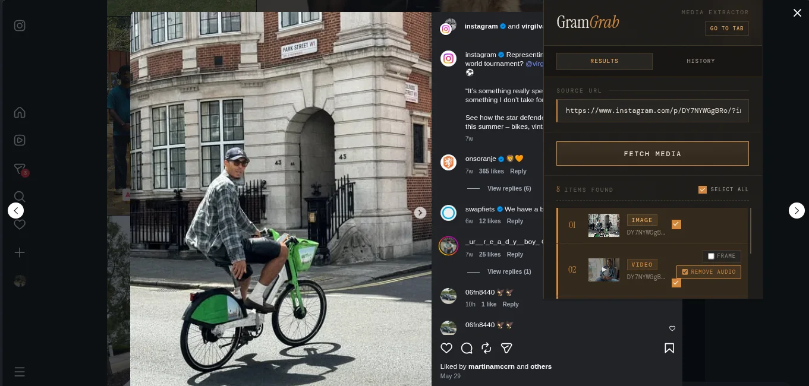
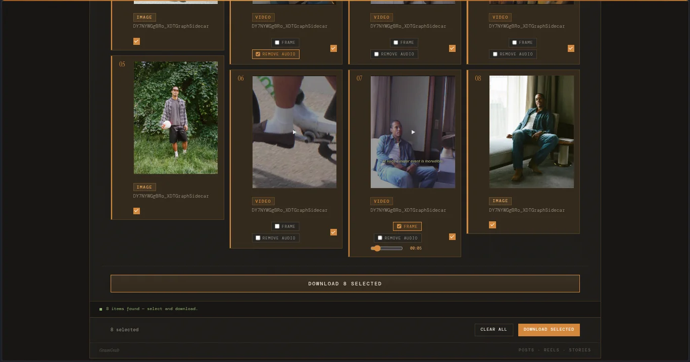

# GramGrab

**GramGrab** is a Manifest V3 browser extension for Chromium browsers and Firefox. It downloads media through your own browser session, with no third-party service in between. It handles Instagram posts, carousels, reels, stories, highlights, Instants, and profile pictures, plus the WhatsApp Web Status you are viewing. An optional `gramgrab` CLI drives the same operations from a terminal.



Operation failures use stable symbolic codes and action-led recovery. See [the error model](docs/error-model.md) for the canonical registry and diagnostics policy.

---

## Features

### Instagram

- **Posts & Carousels.** Download single images or every image in a multi-photo post at once
- **Reels.** Save short-form video content as MP4
- **Stories.** Download active stories from any accessible profile
- **Highlights.** Save archived story highlights
- **Instants.** Click **Load Instants** to fetch the photos and videos in your active Instants feed, with no URL
- **Profile pictures.** Fetch the highest-resolution profile picture available
- **Watches (Beta).** Follow an account's Posts, Stories, Instants, or profile picture. GramGrab checks about twice a day while the browser is open and can notify you, download what it finds, or collect it in an Inbox on the Watches page
- **Second login (Beta, Chromium).** Link one more Instagram login from an Incognito window, then pick which login fetches or owns a Watch

### WhatsApp

- **Visible Status capture.** Capture the photo or video Status currently open in WhatsApp Web, one click per capture
- **Invocation-scoped access.** GramGrab reaches WhatsApp Web only through `activeTab`, so it can see the page only when you invoke it, never in the background
- **Memory-only handling.** Captured bytes are never written to extension storage, and are released on download, on failure, on popup close, or at a flat 10-minute editing ceiling, whichever comes first
- **Name-free output.** Filenames and history receipts carry no contact name or WhatsApp identifier, and WhatsApp receipts have no redownload button

### Shared

- **Batch selection.** Cherry-pick which items to download from any result set
- **Preview thumbnails.** See images and videos before you download
- **Active tab detection.** The popup fills in the Instagram URL from your active tab, and offers Status capture when that tab is WhatsApp Web
- **Export video frame.** Choose a timestamp and download a JPEG still instead of the MP4
- **Silent video export.** Create a video-only MP4 when the source contains an audio track
- **Rotate and crop.** Turn an item by 90, 180, or 270 degrees or crop it before download. A rotated or cropped image is re-encoded as JPEG. A rotated video keeps its streams and only gets new rotation metadata, while a cropped video is re-encoded as H.264
- **Download history.** Review accepted downloads, remove entries, clear history, and redownload an Instagram item
- **Workspace tab.** Move large result sets and active batches from the popup into a dedicated tab
- **Dark/light theme.** Follows your OS preference



_Open larger collections in GramGrab's responsive workspace to preview, configure, and batch-download media._

---

## Requirements

- **Chromium 111+**, such as Chrome, Edge, Brave, or Helium, or **Firefox 115+**. The build targets Chrome 111, so older Chromium cannot run it. Firefox needs 130+ for frame export and silent video, which use WebCodecs
- An active, logged-in Instagram session in the same browser profile
- A logged-in WhatsApp Web session, for Status capture
- Node.js 22.18+ or 24.2+ for the optional CLI
- Node.js 24 plus the Vite+ CLI workflow, only if building from source

> Stories, highlights, and some metadata require that you are logged in to Instagram.

---

## Installation

### Option A: Install a release (recommended, updates itself)

Every [GitHub release](https://github.com/zytact/GramGrab/releases/latest) carries a signed
`gramgrab.crx` and `gramgrab.xpi`. Installed from there, the browser checks the latest release for
updates on its own.

**Helium, Chromium, or another Chromium browser on Linux**

- Helium only: open `helium://flags`, set **Handling of extension MIME type requests** to
  **Always prompt for install**, and relaunch.
- Open the `gramgrab.crx` link from the release and click **Add extension**.

The browser checks for updates at startup, and **Update** in `chrome://extensions` (developer mode)
checks immediately. A downloaded update installs the next time the browser starts, because
GramGrab's background worker stays connected to the CLI bridge. Off-store CRX installs only work on
Linux; on Windows and macOS use Option B.

**Firefox**

- Open the `gramgrab.xpi` link from the release and click **Add**. Mozilla has signed it, and
  Firefox updates it like any other add-on.

### Option B: Load the extension from source

1. Clone or download this repository.
2. Run the build to generate browser-specific output directories:
   ```bash
   vp install
   vp run build            # builds both targets
   # or build individually:
   vp run build:chromium   # → extension/chromium/
   vp run build:firefox    # → extension/firefox/
   ```
3. Load the extension into your browser:

   **Chrome / Edge / Brave**
   - Navigate to `chrome://extensions`
   - Enable **Developer mode** (toggle, top-right)
   - Click **Load unpacked** and select the **`extension/chromium/`** folder

   **Firefox**
   - Navigate to `about:debugging#/runtime/this-firefox`
   - Click **Load Temporary Add-on…**
   - Select any file inside the **`extension/firefox/`** folder (e.g. `manifest.json`)

4. The GramGrab icon will appear in your browser toolbar.

Builds loaded this way never update themselves. The Chromium build carries the release key, so it
has the same extension ID as a release install and cannot sit next to one in the same profile.

> **Why separate folders?** Chromium MV3 requires a `service_worker` background entry; Firefox MV3 uses `scripts`. The two builds share the same TypeScript source but get different generated `manifest.json` files.

### Option C: Development mode (live rebuild)

```bash
vp install
vp run dev            # live-rebuilds the Chromium target (extension/chromium/)
vp run dev:firefox    # live-rebuilds the Firefox target (extension/firefox/)
```

Then load the matching `extension/chromium/` or `extension/firefox/` folder as an unpacked extension (same steps as above). Reload the extension in the browser after each rebuild.

### Command-line tool (optional)

On Linux and macOS, install the `gramgrab` CLI and its native host with:

```bash
curl -fsSL https://github.com/zytact/GramGrab/releases/latest/download/install.sh | sh
```

`gramgrab update` moves both to the latest release. See [CLI setup](docs/cli-setup.md) for the
one-time native-host registration.

---

## How to Use

1. **Open Instagram** in a browser tab and navigate to a post, reel, story, highlight, or profile page.
2. **Click the GramGrab icon** in your toolbar to open the popup.
   - The URL field auto-fills with the Instagram URL from your active tab. If it doesn't, paste the URL manually.
3. **Click "Fetch Media"** (or press Enter). GramGrab queries Instagram for the available media items.
4. **Review the results.** Each item shows a thumbnail, media type badge (image / video), and a filename hint.
   - Use the **Select all** checkbox or tick individual items.
5. **Click "Download N Selected"** to save the chosen files. The browser's own downloads handle the rest, so files land wherever your browser saves downloads.

For Instants, skip the URL and click **Load Instants** in step 3.

### Capturing a WhatsApp Status

1. **Open the Status** you want in WhatsApp Web's Status viewer.
2. **Click the GramGrab icon.** The popup detects the WhatsApp tab and offers Status capture instead of a URL field.
3. **Click "Capture Visible Status".** GramGrab reads the photo or video currently on screen, then lets you preview it, export a frame, or drop the audio track before saving.

> WhatsApp view receipts are controlled by WhatsApp. GramGrab causes no extra receipt and does not make viewing anonymous. Captures are kept in memory and expire 10 minutes after capture.

### Supported URL formats

| Content type      | Example URL                                                   |
| ----------------- | ------------------------------------------------------------- |
| Post / carousel   | `https://www.instagram.com/p/ABC123/`                         |
| Carousel item     | `https://www.instagram.com/p/ABC123/?img_index=2`             |
| Reel              | `https://www.instagram.com/reel/ABC123/`, or `/reels/ABC123/` |
| Story             | `https://www.instagram.com/stories/instagram/`                |
| Highlight         | `https://www.instagram.com/stories/highlights/12345678/`      |
| Profile (picture) | `https://www.instagram.com/instagram/`                        |

A post or reel URL may also start with the account name, as in
`https://www.instagram.com/instagram/p/ABC123/`. A Story URL that ends in a Story ID loads the
account's whole active Story set.

---

## Building from Source

```bash
# Install dependencies
vp install

# Production builds
vp run build            # both targets
vp run build:chromium   # → extension/chromium/
vp run build:firefox    # → extension/firefox/

# Package Firefox extension as XPI
vp run package:firefox   # → extension/firefox/gramgrab.xpi
# Package Chromium extension as CRX (needs the release key, see docs/releasing.md)
vp run package:chromium  # → extension/chromium/gramgrab.crx

# Watch mode (rebuilds on save)
vp run dev              # Chromium watch (extension/chromium/)
vp run dev:chromium     # same as above
vp run dev:firefox      # Firefox watch (extension/firefox/)

# Run tests
vp test run
vp test

# Format, lint, and type check in one pass
vp check

# CLI and native host, bundled into artifacts/
vp run package:tools
```

The extension lives in `apps/extension`. Its Vite build root is `apps/extension/templates`, which holds three HTML entries. `popup.html` serves the popup and the workspace, `options.html` is the Watches page, and `runner.html` is the export runner. `apps/extension/src/background.ts` and the WhatsApp controller `apps/extension/src/whatsapp/controller-entry.ts` are bundled as plain JS entries with no HTML wrapper. A build plugin writes each browser's `manifest.json` and copies the icons, `LICENSE`, and `THIRD_PARTY_NOTICES` into the output directory. Task caching is off for every `vp run` task, because the browsers load build output directly and a stale cached build is too easy to miss.

---

## How It Works

GramGrab has two pages people use, a background worker, and two short-lived execution surfaces:

- **Popup UI.** `apps/extension/templates/popup.html` loads the React app from `apps/extension/src/popup.tsx`. It handles URL input, WhatsApp Status capture, media listing, selection, previews, frame and silent-video choices, history, workspace actions, and status feedback. With `?surface=workspace` the same page runs as the full-tab workspace.
- **Watches page.** `apps/extension/templates/options.html` is the extension's options page. It holds Watches, their Inbox and Needs you lists, Watch export and import, and second-login linking.
- **Background service worker.** `apps/extension/src/background.ts` handles Instagram requests, strict response decoding, browser downloads, history persistence, context-menu commands, workspace coordination, Watch checks on an alarm, and the native-messaging bridge to the CLI. The popup reaches it through a single message listener backed by a handler registry, which keeps asynchronous work alive with `sendResponse` plus `return true` for Chromium and Firefox compatibility.
- **Runner document.** Frame extraction and silent-video re-encoding need media APIs a service worker does not have, so the worker opens a minimized runner window to execute those exports and report progress back.
- **WhatsApp controller.** Status capture injects a one-shot isolated-world script into the WhatsApp tab you invoked GramGrab on, streams the visible media back over a bounded message port, and tears the script down when the capture ends. GramGrab declares no permanent content scripts and no WhatsApp host permission, so it has no standing access to the page.

Shared domain code lives under `apps/extension/src/` (`effect/` for Instagram requests and schemas, plus focused modules for downloads, exports, history, errors, and the workspace). Cross-application wire contracts live in `packages/protocol`, which the optional local CLI (`apps/cli`) and native host (`apps/native-host`) share with the extension. Workspace handoff uses a versioned, short-lived, memory-only browser-session transfer, so a popup can open or replace a dedicated workspace tab without losing its current source, results, or export settings.

> GramGrab does not use an application backend or third-party analytics service. The extension makes requests from your browser to Instagram endpoints and the `fbcdn.net` media CDN, using the browser's authenticated session where required. WhatsApp media is read from the page you are viewing and held in memory only. GramGrab stores download history in extension-local storage and keeps short-lived workspace handoff data only in memory-backed browser-session storage; media URLs and diagnostics can also exist transiently in active UI state.

---

## Permissions

| Permission                            | Why it's needed                                                                                                                                                             |
| ------------------------------------- | --------------------------------------------------------------------------------------------------------------------------------------------------------------------------- |
| `downloads`                           | Save media files and debug exports to disk                                                                                                                                  |
| `storage`                             | Persist download history, workspace handoff state, and your Watches on this device                                                                                          |
| `cookies`                             | Read the Instagram CSRF token right before a request that sends it back, and copy the Instagram cookies of an Incognito window when you link a second login                 |
| `activeTab`                           | Temporarily access the current tab when GramGrab is invoked                                                                                                                 |
| `scripting`                           | Inject the one-shot isolated WhatsApp capture controller                                                                                                                    |
| `tabs`                                | Read and manage tabs for URL detection and the GramGrab workspace                                                                                                           |
| `contextMenus`                        | Add GramGrab actions to page and link context menus                                                                                                                         |
| `nativeMessaging`                     | Expose GramGrab operations to the local CLI bridge                                                                                                                          |
| `alarms`                              | Wake GramGrab to run your Watch checks while the browser is open                                                                                                            |
| `declarativeNetRequestWithHostAccess` | Mark GramGrab's own Instagram requests as coming from instagram.com, which Instagram requires, and send the linked second login's cookies with requests made for that login |
| `webRequest`                          | Keep the stored cookies of the linked login current with what Instagram sets on its requests                                                                                |
| `notifications`                       | Tell you what a Watch check found, if you ask it to                                                                                                                         |
| `https://*.instagram.com/*`           | Fetch media metadata from Instagram                                                                                                                                         |
| `https://*.fbcdn.net/*`               | Load media previews and videos from Instagram's CDN                                                                                                                         |

`webRequest` is requested on Chromium only, where the second login works. `notifications` is optional, and the Watches page asks for it the first time you choose to be notified.

---

## Refreshing Instagram API schemas

GramGrab decodes every Instagram API response through strict Effect schemas. If Instagram changes its response format, the extension shows _"Instagram's format has changed"_ with the code `IG_RESPONSE_SHAPE_UNKNOWN`.

If the request itself stopped working because Instagram changed an App ID, ASBD ID, GraphQL
identifier, endpoint, or transport, follow the
[Instagram protocol refresh guide](docs/instagram-protocol.md) first.

To fix it:

1. Configure capture subjects in the repository-root `.env` (copy `.env.example` if needed).
2. Run `vp run generate:ig-fixtures`, then paste `.local/capture-ig-fixtures.mjs` into DevTools on
   `https://www.instagram.com` (logged in).
3. Download the raw JSON files into `.local/raw-fixtures/` and sanitize them before replacing
   anything in `apps/extension/src/effect/__fixtures__/`. Run `vp run sanitize:ig-fixtures` to validate and stage
   the complete capture set, review the value-free output, then run
   `vp run sanitize:ig-fixtures -- --write` to install all eleven captured fixtures in one transaction.
   The sanitizer is the privacy boundary for committed captures.
4. Run `vp test run`. Failing tests show exactly which fields changed.
5. Update `apps/extension/src/effect/schemas.ts` to match the new shape, re-run tests, ship only sanitized fixtures.

---

## Limitations

- **Login required.** You must be logged in to Instagram in the same browser profile. Private content is only accessible if your account follows that profile.
- **API fragility.** GramGrab uses Instagram's internal, undocumented GraphQL endpoints. Instagram may change these without notice, which can break fetching until the extension is updated.
- **Time-limited CDN URLs.** Instagram media URLs expire after a few hours. Downloads initiated through GramGrab must complete before the URL expires.
- **Local download history.** GramGrab records accepted downloads locally in extension storage. It
  stores the canonical source URL, media identity, filename hint, export mode, rotation, crop, and
  timestamp, but not the temporary media or preview URL. History is capped at 1,000 entries and can be deleted from the
  popup.
- **Workspace lifetime.** Workspace transfers are short-lived handoffs between the popup and a
  dedicated extension tab. They expire after 60 seconds and are sanitized before being written to
  browser-session storage, which the browser clears when it closes.
- **File formats.** Images and video frames are saved as `.jpg`, and videos, silent videos included, as `.mp4`.
- **WhatsApp capture is one Status at a time.** GramGrab captures the Status currently open in the tab you invoked it on. There is no armed mode that follows you through a Status sequence, and the GramGrab workspace tab cannot be a capture surface.
- **WhatsApp editing expires.** A capture is usable for 10 minutes from the moment it completes. Previewing or scrubbing does not extend that, and an export that would not finish in the remaining time is refused before it starts.
- **WhatsApp view receipts.** Receipts are controlled by WhatsApp. GramGrab neither suppresses nor adds one.

---

## Contributing

Pull requests are welcome. Before submitting, run `vp check`, `vp test run`, and `vp run fallow`. Build both browser targets with `vp run build:chromium` and `vp run build:firefox`. The project uses Vite+ as the primary workflow surface, so prefer `vp` commands over package-manager wrappers when developing locally or in CI.

### Dependency policy

The committed `pnpm-lock.yaml` is authoritative for reproducible installs. CI uses `vp install --frozen-lockfile` and fails when dependency declarations and the lockfile drift.

Vite+, its Vite core alias, and its Vitest alias are a coordinated pre-1.0 toolchain. Their exact versions in `package.json` and the overrides must be updated together. Dependabot checks npm dependencies weekly and groups these three packages in a single pull request. Dependency updates are never merged automatically: validate each update with `vp check`, `vp test run`, both production builds, and `vp run fallow` before merging.

---

## Disclaimer

This extension is an independent project and is not affiliated with, endorsed by, or connected to Instagram or Meta in any way. Use it responsibly and in accordance with [Instagram's Terms of Use](https://help.instagram.com/581066165581870). Only download content you have the right to access and save.
